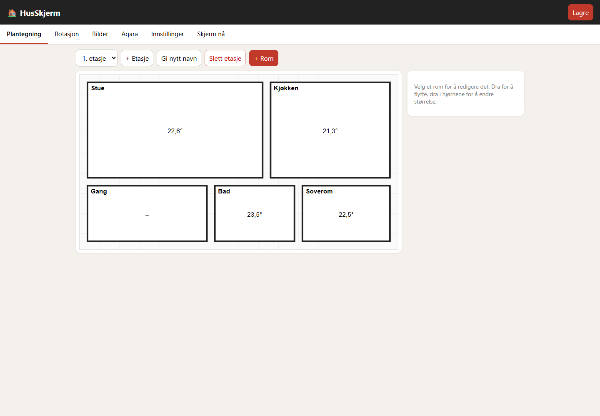
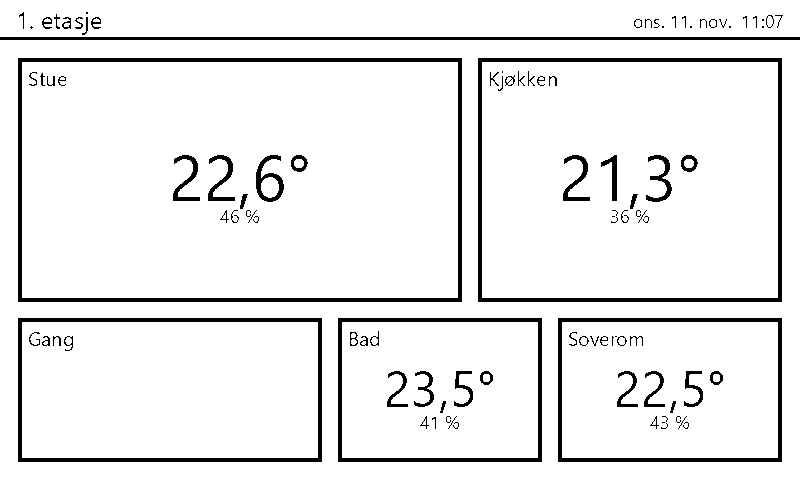

# HusSkjerm

Smarthusstatus på en 7,5" e-ink-skjerm (Waveshare 800×480, svart/hvit/rød) drevet av en Raspberry Pi.

- Roterer mellom plantegning av **1. etasje**, **kjeller** og en **temperatur-/værskjerm** (yr.no).
- Temperaturen vises midt i hvert rom. Verdier utenfor grensene (standard 15–26 °C) vises i rødt.
- Sensorer hentes fra **Aqara** sin sky-API.
- **Kontrollpanel** (nettside på Pi-en, tilgjengelig på samme Wi-Fi): tegn rom som firkanter, flytt og endre størrelse, gi navn, koble sensorer, sett visningstid, legg til egne bilder.

## Struktur

| Mappe | Innhold |
|---|---|
| `src\HusSkjerm` | ASP.NET-app: panel, Aqara, vær, tegning, skjermdriver |
| `tests\HusSkjerm.Tests` | xunit-tester |
| `deploy` | `publish.ps1`, `install.sh`, `husskjerm.service` |
| `docs\RASPBERRY-PI-OPPSETT.md` | Full oppsettsguide |

## Kjør på PC (uten skjerm)

Krever .NET 10 SDK og tilgang til NuGet for første bygg. Fra en fersk klone kopierer du den rensede eksempelkonfigurasjonen. Den bruker fiktive sensorer og vær og filbasert skjermdriver; ekte maskinvare trengs ikke:

```powershell
cd src\HusSkjerm
Copy-Item appsettings.example.json appsettings.json
$env:HUSSKJERM_Aqara__Mock = "true"; $env:HUSSKJERM_Weather__Mock = "true"
dotnet run
```

Åpne http://localhost:8080. På Windows skrives skjermbildet til `data\current.png` i stedet for e-ink. Mock-modus gir falske sensorer og vær.

## Eksempelbilder

Bildene viser en isolert demo med eksempelrom og fiktive sensorverdier. Ingen plantegning, bilder eller posisjon fra brukerens lokale data er tatt med.





## Konfigurasjon og hemmeligheter

`appsettings.json`, lokale overstyringer og hele `data/` utelates fra Git. `appsettings.example.json` inneholder bare rensede standardverdier. Oppgi egen Aqara-konto og nøkler i lokale filer eller miljøvariabler med prefiks `HUSSKJERM_`, for eksempel `HUSSKJERM_Aqara__AppKey`. Sett `Aqara:Mock` og `Weather:Mock` til `false` først når ekte tjenester er konfigurert. Værtjenesten trenger posisjon i panelet og en identifiserende `Weather:UserAgent`. Se [oppsettsguiden](docs/RASPBERRY-PI-OPPSETT.md) for maskinvare og oppsett. La `Display:Driver` stå på `File` på PC; velg `Auto` eller e-ink-driver på Pi.

## Viktig om e-ink

Tre-farget e-ink bruker **15–20 sekunder** på hver oppdatering, og produsenten anbefaler minst 180 s mellom hver. En visningstid på 10 s fungerer derfor ikke i praksis (skjermen blir stadig opptatt og slites). Verdien er konfigurerbar; bruk minst 180 s for fysisk e-ink. Se guiden.

Test: `dotnet test tests\HusSkjerm.Tests`.

Bygg og alle 9 tester besto 11. november 2026. Kontrollpanelet og e-ink-forhåndsvisningen er kontrollert lokalt med renset konfigurasjon og fiktive sensorer. Ekte Aqara-innlogging og fysisk skjerm er ikke verifisert i denne kontrollen.
